# Benchmark architecture

The benchmarks in `benchmarks/` compare pyseiskit with Seismic Unix. They own very little:
the list of cases, SU file handling, a correctness check and a speedup report. Everything
about timing is [pyperf](https://pyperf.readthedocs.io)'s: worker processes, loop
calibration, warmups, statistics, CPU pinning, system metadata, the JSON format and the
significance tests. How to run and extend it is in
[benchmarks/README.md](../benchmarks/README.md).

## Context

Both implementations do the same work on the same input: read an SU file, compute, write
an SU file. Before anything is timed, every case runs once on both sides and the outputs
must match, so a benchmark never times a wrong result.

## Containers

Each side is one pyperf run that writes its own results file, with the same benchmark
names on both sides. `python -m benchmarks.report.cli` reads both and gives every case's speed
relative to SU, end to end and for the computation alone.

Decisions worth knowing:

1. **pyperf instead of our own harness.** It is maintained by the Python Software
   Foundation and is the standard for Python benchmarks; we write no statistics.
2. **SU is timed as a command line, pyseiskit as a library.** An SU benchmark includes
   starting the program; a pyseiskit benchmark runs in a worker that has already
   imported pyseiskit. So the report shows two speedups: end to end, and compute alone
   (SU's estimated as its time minus the `io` benchmark, plain `sugain`; pyseiskit's
   measured on data in memory). On small inputs the two can point in opposite directions.
3. **The same I/O work on both sides.** pyseiskit reads and writes each file in one pass
   with numpy, as an SU program does. segyio was tried first, but it cannot create an SU
   file, so writing meant copying the input and rewriting it: twice SU's I/O time.
4. **Inputs come from SU** (`suplane | suaddnoise`, seeded), with a different sample
   interval per size, so a function that hard-codes `dt` fails the check.
5. **Pinned to one performance core by default, outputs in RAM** (`/dev/shm`). On this
   hybrid CPU an efficiency core ran sugain 2.4x slower, and disk writeback added noise.
6. **No memory comparison.** pyperf's memory tracking would report the Python worker,
   not the SU program, so the numbers would not be comparable.

Diagrams: Mermaid sources next to the SVGs in `docs/diagrams/benchmarks/`; regenerate
with `docs/diagrams/benchmarks/render.sh`.
